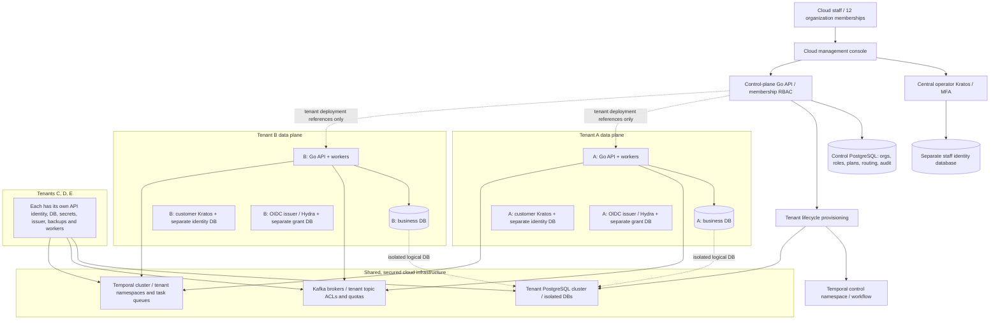

# Customer Fabric Cloud — control and data planes (proposed target architecture)

**Status:** target product decision for review, **not implemented**. Cloud is a managed multi-tenant offering; the Apache-2.0 self-hosted product retains independent single-organization operation. See [Cloud epic #90](https://github.com/buelbuel/customer-fabric/issues/90), [roadmap #8](https://github.com/buelbuel/customer-fabric/issues/8) and [event/workflow design](eventing-workflows.md). The current M1 runtime still refuses non-development mode and uses synthetic data only.

## Five-company reference topology

Five paying organizations, with staff membership counts 2, 2, 2, 2, 4 = **12 memberships**. They may correspond to fewer than twelve unique people if an individual has authorized memberships in multiple organizations. Never infer membership from matching email.

Arrows represent conceptual relationships, **not cross-database SQL queries**. Kratos and Hydra need separately isolated persistence and credentials; their databases may reside on the appropriate tenant data PostgreSQL infrastructure, but never share ordinary Customer Fabric tables. Temporal also has its own backend persistence, separate from both the management DB and tenant business databases.

### What is shared

- **Management control plane**: organizations/tenants, invitations, staff memberships, role policy, subscriptions/plans, usage accounting, region/deployment registry, tenant provisioning, minimally necessary audit.
- **Staff identity provider**: one Cloud-level operator identity realm with MFA and protected bootstrap/recovery. One staff identity may have explicitly approved membership in multiple organizations. The Cloud staff identity is not the end-customer identity of any tenant.
- **Kafka and Temporal infrastructure**: initially common secured clusters, but distinct tenant topics/principals/ACLs/quotas and Temporal namespaces/task queues/worker credentials.
- **Software**: common Go/React build artifacts, migration versions and operations automation. Sharing code does not require sharing execution contexts, passwords or customer databases.

### What is tenant-specific

- Customer Fabric profile/identifier/provenance/ownership/consent/segmentation state, source and connector secrets, event data, erasure journal and backups.
- Business customer identity: dedicated tenant Kratos issuer, identity storage, keys, verification/recovery policy; same email in A and B is not the same subject.
- If OIDC is provided: tenant-specific OAuth/OIDC issuer, application clients, scopes, JWKS/signing material and Hydra grant storage. Verify Hydra's currently applicable self-hosted production license before selecting its distribution.
- Tenant Go API and worker configuration, persistent source credentials, Kafka topic principal, Temporal workflow namespace/task queues and encryption keys.
- Controller/purpose/legal basis: **one configured controller per tenant deployment** by default. Customer Fabric Cloud is a processor/operator of the service as determined by the actual legal arrangements, not the universal controller of all tenants.

## PostgreSQL topology: logical databases versus servers

For the first five Cloud tenants:

1. **Control PostgreSQL deployment** — a physically and credential-separated service storing organizations, roles, plans, deployment references and minimal operational audit. Central staff Kratos stores its credential/identity records in its own separate logical database/role.
2. **Tenant data PostgreSQL deployment** — one managed cluster with **five distinct logical databases** (`tenant_a`, …, `tenant_e`) for Customer Fabric business state, individual DB roles and encryption/backup isolation. Tenant Kratos/Hydra persistence should use separately scoped databases/roles, not the business schema.
3. **Dedicated cluster upgrade path** — migrate a high-volume or regulated tenant to a separate managed PostgreSQL instance/cluster with its own backups/network/keys. This requires tested per-tenant migration, not a full Cloud migration.

Logical DB isolation stops accidental shared-table joins and allows distinct access credentials, but it is **not** the same as a separate host: there may still be a shared superuser, physical backups, resource contention and infrastructure blast radius. Require resource/noisy-neighbor controls, independent restore/export and incident tests. Never give an API database owner/superuser credentials.

At this five-tenant scale, prefer **one tenant-bound Go API + worker deployment per tenant**. Each starts with exactly one tenant business DSN and tenant credentials. The ingress/router validates trusted hostname, issuer/audience and staff membership when relevant and resolves an immutable tenant deployment mapping. Do not select arbitrary tenant DSNs from an untrusted request body.

## Cloud admin example

| Paying organization | Active organization admin memberships | Business/customer identity and storage |
| --- | ---: | --- |
| A | 2 | A customer Kratos issuer; A Customer Fabric DB |
| B | 2 | B customer Kratos issuer; B Customer Fabric DB |
| C | 2 | C customer Kratos issuer; C Customer Fabric DB |
| D | 2 | D customer Kratos issuer; D Customer Fabric DB |
| E | 4 | E customer Kratos issuer; E Customer Fabric DB |

A staff operator authenticates to the shared Cloud staff issuer and selects a company only if an **active membership** grants access. The control plane authorizes membership and role on **every** sensitive action, including tenant switch, connector-secret changes, export, erasure, billing and operator invitations. The tenant's end users never acquire Cloud staff roles from their tenant customer account.

## Provisioning, data lifecycle and operations

- **Temporal control workflows** provision tenant DBs, distinct secrets, migrations, Kratos, OIDC (if enabled), Kafka ACLs/topics, Temporal namespaces/task queues, ingress and backup policies. Use deterministic workflow IDs and compensations; do not automatically delete data volumes after a failure.
- **Cloud regions**: tenant DB, customer identity, connector data, Kafka topics, Temporal workflow histories, logs, encryption keys and backups must satisfy the selected region and contractual/legal residency controls.
- **Tenant closure**: suspend ingress/worker activation, revoke source/OAuth credentials, export where lawfully authorized, execute customer/processor retention workflows, remove Kafka/history data under approved policy, age out backups and prove no stale replay. Never claim instantaneous erasure of immutable backups.
- **Isolation verification**: synthetic A/B/C/D/E users and operators; deliberate wrong DB credentials, host routing, issuer/audience, Kafka topic permission, Temporal namespace/task queues and restored backup. Fail closed on mismatch.
- **Metering and economics**: control plane records usage/plan caps, not personal customer events. Evaluate Kafka partition, Temporal workflow, DB/IdP, egress, backup and on-call costs for five customers.

## Open design decisions for ADR and implementation

- Shared versus dedicated PostgreSQL **cluster** by tenant tier, per-tenant restore and physical backup isolation.
- Appropriate separate Kratos and OIDC issuer topology, keys and self-hosting licensing.
- Temporal namespace-per-tenant versus task-queue-per-tenant when customer count grows; five regulated tenants can justify namespaces.
- Kafka topic granularity and ACL/quotas with deletion-safe retention and event schema governance.
- Cloud staff cross-tenant support access: break-glass, reason/approval, expiry, auditable impersonation prohibition.
- Self-hosted support for Kafka/Temporal without the Cloud control plane, with managed infrastructure alternatives documented.

**This architecture does not imply completed implementation or production readiness.** Implement and test via #91–#100; retain M5 privacy/security gates.
