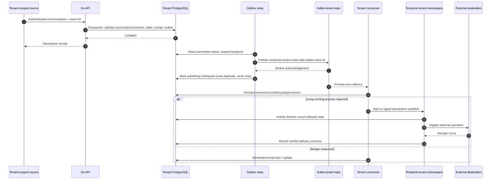

# Kafka and Temporal as first-class platform services (proposed target)

**Status:** approved product direction; design proposed; the ADR is owed by #64 and no implementation comes before it. Apache Kafka and Temporal are approved for the target Customer Fabric architecture. Neither is implemented in the M0/M1 development stack. PostgreSQL remains the **system of record** for current profiles, identity links, field ownership, consent evidence and mutation receipts. The [Cloud design](cloud-control-plane.md) scopes their multi-tenant deployment, and [issue #64](https://github.com/buelbuel/customer-fabric/issues/64) tracks integration.

## Responsibilities and non-responsibilities

| System | Owns | Does not own |
| --- | --- | --- |
| PostgreSQL + pgx/goose/sqlc | Transactional profile, consent, identifiers, provenance, outbox and lifecycle state | Inter-service event delivery or long-running orchestration |
| **Apache Kafka** | Asynchronous, partitioned event transport, replay within bounded retention, integration consumers, durable delivery buffer | Customer identity authority, business transactions, perpetual PII storage or workflow timers |
| **Temporal** | Durable business workflows, retries, waits/timeouts, approvals and compensation for imports, source reconciliation, consent downstream, DSAR/erasure and Cloud tenant lifecycle | Source-of-truth profiles, Kafka-style large-volume event streaming, or raw customer-data warehouse |
| Customer Fabric Go processes | REST APIs, transactional domain logic, outbox relay, Kafka consumers and Temporal activities/workers | A mandatory fleet of unrelated microservice repositories |

Privacy workflows execute obligations held in the PostgreSQL ledger and move forward only. Compensation applies to provisioning and imports.

A single Go backend module may produce API, Kafka-relay/consumer and Temporal worker executables or modes. Workflows are for durable long-running operations, **not every trivial page-view or scalar mutation**.

## End-to-end transactional event flow

No global distributed transaction is promised across PostgreSQL, Kafka and Temporal. A process can crash after Kafka acknowledges but before PostgreSQL records the relay checkpoint: duplicate events are possible and **must** be harmless. Consumer dedupe must use durable event/tenant/source identity and lifecycle epoch.

## Kafka decisions

- Per-tenant topics or prefix and per-tenant authenticated producers/consumers with narrow ACLs; limit who can create/delete topics, alter ACLs or inspect consumer offsets.
- Versioned event schemas, schema registry/compatibility policy and stable typed envelopes: tenant ID, event ID, source identity, record epoch, optional workflow correlation ID, event/ingest times, purpose classification and schema version.
- Ordering is per partition key, not global across all tenants or all customer records. Detect and quarantine late/out-of-order events when source-time trust is missing.
- Source backfill, CDC, behavioral event collection (if approved), invalidation events, consent withdrawals and authorized integration updates may be signalled through Kafka as opaque references and metadata.
- Enforce producer quotas, consumer backpressure, bounded retention and DLQ quarantine per tenant. Authentication, encryption, monitoring and per-tenant throughput accounting are mandatory in Cloud.
- Payloads and partition keys are opaque references and metadata. Raw personal payloads are not allowed in Kafka: backfill and CDC records stay in the tenant database or its staging area, and an exception needs an amendment to the privacy ADR. Kafka log compaction or tombstone insertion alone is **not** a guarantee of immediate physical PII erasure.

## Temporal decisions

- Use durable workflows for connector import checkpoints, source reconciliation, customer data access/export, erasure propagation/processor acknowledgements, key rotation, incident recovery and Cloud tenant provisioning/decommission.
- Workflow logic must be deterministic and versioned; activities may interact with Postgres, Kafka and external APIs but require idempotency and explicit retry/backoff/timeout policies.
- Store **opaque references and minimal status** in workflow arguments/results/search attributes; histories, visibility indexes and history backups can be personal-data copies. Fetch business data through tenant-bound activities using current authorization.
- Each tenant has a credential-enforced boundary, by default a namespace with its own worker credentials. Task queues only route work inside that boundary.
- Maintain a separate Cloud control namespace for provisioning and billing-related workflows, isolated from all tenant business and privacy workflows; the Temporal server's own persistence is separate from Cloud metadata DBs.
- A Go worker should be configured for exactly one tenant deployment (initial baseline); never accept an untrusted tenant DB connection or Kafka topic in workflow parameters.

## Consent, erasure and replay invariants

1. **Consent-dependent activation is checked at the final dispatch point**, not merely when an event enters Kafka; a withdrawal or erasure epoch fences queued retries.
2. Consumer and destination must enforce tenant ID, subject/record lifetime and source epoch. Old source messages cannot silently resurrect erased records after an idempotency receipt expires.
3. Temporal workflow cancellation is not enough for erasure: coordinate durable suppression, downstream delete requests and acknowledgments, and storage/backup retention.
4. Kafka topics, DLQs, workflow histories/search indices and backups are independently enumerated data categories in privacy retention rules.
5. When a tenant is suspended, worker activities stop sending and events remain controlled by explicit short retention/operational quarantine policy, not unbounded unobserved queues.
6. Workflows are not a substitute for the tenant-scoped lifecycle journal, which lives outside the tenant's PostgreSQL recovery domain and never in the control plane.

## Development, operation and safety gates

- Build a real **synthetic** vertical slice: PostgreSQL committed outbox -> Kafka relay -> tenant topic -> consumer -> Temporal workflow/activity -> eligible synthetic destination. Fault-inject broker downtime, relay restart, duplicate deliveries, Temporal unavailable, worker retry and crash.
- Add isolated Compose profiles for Kafka/Temporal with deterministic versions, secrets, health checks and local worktree isolation. Heavy infrastructure may remain an opt-in local development profile while production architecture still includes it.
- Pin/scan images and libraries, add contract/compatibility tests, verify Kafka ACL-denial and Temporal namespace-denial with two synthetic tenants, and publish redacted per-tenant metrics.
- Document upgrades, production persistence of Kafka log directories/Temporal backend DB, cluster failover, consumer lag, quotas, retained data and region placement. The shared Cloud control PostgreSQL is **not** Temporal's persistence DB.
- Preserve the single Go modular-monolith source tree, the existing profile+provenance+outbox transaction and versioned source ownership.

## References and tracked work

- [Kafka multi-tenancy — Apache](https://kafka.apache.org/42/operations/multi-tenancy/)
- [Temporal multi-tenant application patterns](https://github.com/temporalio/documentation/blob/main/docs/best-practices/multi-tenant-patterns.mdx)
- [M3 epic #11](https://github.com/buelbuel/customer-fabric/issues/11)
- [Kafka/Temporal target architecture #64](https://github.com/buelbuel/customer-fabric/issues/64)
- [Outbox to Kafka and workflows #36](https://github.com/buelbuel/customer-fabric/issues/36)
- [Kafka tenant separation #96](https://github.com/buelbuel/customer-fabric/issues/96) / [Temporal tenant separation #97](https://github.com/buelbuel/customer-fabric/issues/97) / [Cloud provisioning #98](https://github.com/buelbuel/customer-fabric/issues/98)
- [Privacy lifecycle ADR 0003](../adr/0003-data-lifecycle.md)
